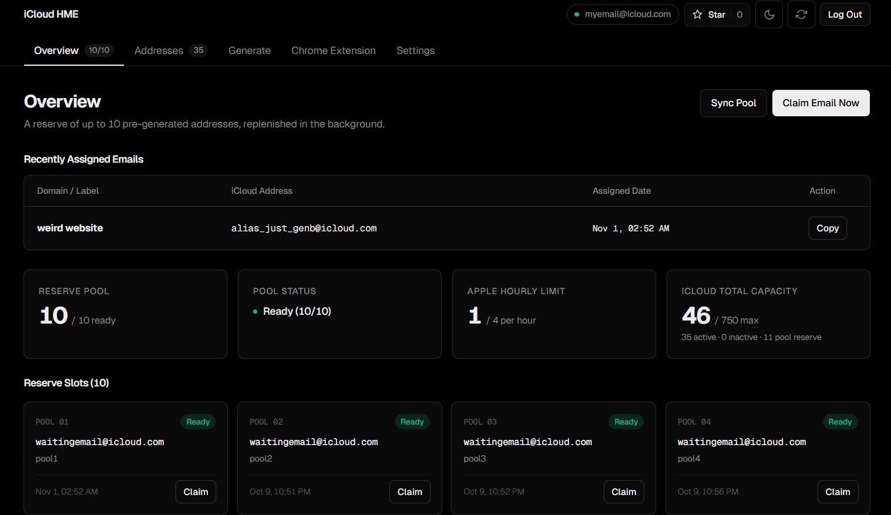
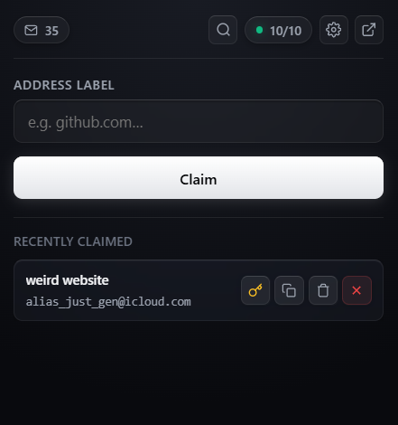
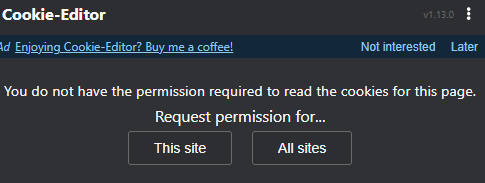
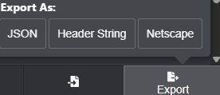
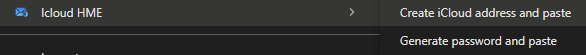

# iCloud Hide My Email Extension

<table>
  <tr>
    <td width="76%" valign="top">
      
    </td>
    <td width="24%" valign="top">
      
    </td>
  </tr>
</table>

I built this because I was tired of opening my iCloud settings every time I needed a new email alias. I wanted a real iCloud address I could use as a disposable email, but creating one took too many clicks and interrupted whatever I was doing. Apple's Passwords app already worked well for me through its browser extension, and I wanted that same convenience for Hide My Email. So I built it myself.

After two months of testing it in my own daily use, I wanted to share it with anyone facing the same frustration. This project combines a self-hosted dashboard with a Chrome extension so you can create and fill aliases directly from your browser. It keeps a reserve of up to 10 addresses ready to use, lets you assign them to websites, rename, deactivate or delete them, and optionally associate generated passwords.

**An active iCloud+ subscription is required to create Hide My Email addresses.** 

Independent project, not affiliated with Apple. Uses private iCloud web endpoints, not an officially supported API.

## Features

The Chrome browser extension connects to your self-hosted server so you can fill signup forms without opening iCloud or switching tabs.

- **Right-click email autofill:** create an iCloud alias and paste it directly into a website's input field.
- **Automatic website labels:** aliases are named after the current website so you can recognize them later.
- **Linked passwords:** generate and fill a password associated with your email address, or reuse a saved one.
- **Alias management:** search your addresses, rename them, deactivate, reactivate or delete them from the dashboard.
- **Paced generation:** built-in delays, hourly limits and cooldowns control how often new aliases are created.
- **Chrome popup:** find existing aliases, copy addresses and access linked passwords from your browser toolbar.
- **Easy setup:** run with Docker or Python, then follow the onboarding to choose your server address and connect iCloud.
- **Internal API:** connect your own scripts and tools using API keys.

## Docker installation

Install Docker with Compose, download or clone this repository, then run from its root:

**Windows PowerShell** (includes automatic LAN and Tailscale interface discovery):

```powershell
powershell -ExecutionPolicy Bypass -File .\start.ps1
```

**Or use Docker Compose directly on any platform** and select **Custom address** during onboarding to enter your preferred server IP or URL:

```sh
docker compose up -d --build
```

Open [**http://localhost:8001**](http://localhost:8001) and follow the onboarding: create your password, choose the extension's server address, paste your iCloud cookies, and download the extension. **No `.env` file or manual configuration is needed.** Docker saves your settings automatically and restarts the server after a reboot while Docker is running.

The container runs as an unprivileged user. A named volume stores private state. No account, cookies or default password are included.

```sh
docker compose logs -f
docker compose down
```

Stopping preserves data. **`docker compose down -v` deletes the data volume and its credentials.** To update, download the new source and repeat the startup command for your platform. On Windows, use the launcher each time to keep host interface discovery enabled.

## Python installation

Requires **Python 3.12+**. From the project root:

```sh
python -m pip install -r requirements.txt
python main.py
```

Open [**http://localhost:8001**](http://localhost:8001) and follow the onboarding.

## First-run onboarding

1. **Password:** create an administrator password of at least 4 characters. This protects the dashboard, not your Apple account. A salted PBKDF2-SHA256 hash is stored.
2. **Network:** choose localhost, a detected LAN interface, Tailscale when available, or choose **Custom address** to enter an HTTP(S) URL manually. Use an address reachable from the computer running the extension. Localhost always refers to that computer. With Docker, use the host address rather than its internal container address.
3. **Cookies:** export your iCloud cookies as described below, paste the Header String and connect. Or click **Explore the app** to open the dashboard without cookies and connect later in **Settings**. Alias management requires a connected iCloud session.
4. **Extension:** follow the Chrome installation steps below. Create an API key in the wizard, copy it immediately into the extension settings, save and test the connection.

The ZIP defaults to the selected server URL and contains **no cookies, API key or account data**. An already saved extension URL takes precedence over the package default. Each browser stores its own settings locally, not in Chrome Sync. Keys are shown once and stored hashed by the server. Revoke and replace lost keys. Additional keys can be created in **Chrome Extension**. Reopen the wizard using **Setup**.

You may also load the source `extension/` folder unpacked; its default URL is localhost. The extension requests HTTP(S) host access to reach your server, plus content-script, clipboard, storage, tab and scripting permissions for website filling. Browser system pages and some protected frames cannot be filled.

## Get your iCloud cookies

1. Install [Cookie-Editor from the Chrome Web Store](https://chromewebstore.google.com/detail/cookie-editor/hlkenndednhfkekhgcdicdfddnkalmdm).
2. Sign in at [icloud.com](https://www.icloud.com/), complete two-factor authentication, and select **Trust this browser / device** when asked.
3. Stay on the signed-in iCloud tab and open Cookie-Editor. If permission is requested, click **This site**.

   
4. Click **Export**, then **Header String**. Your cookie header is copied to the clipboard.

   
5. Paste it into **iCloud cookies** in onboarding and click **Save cookies &amp; connect**. Choose Header String, not JSON. Use the same process in **Settings** to replace an expired session.

Cookies are account credentials. Never share them in an issue, screenshot, commit or extension package. You can also import a root-level `cookies.txt`, but onboarding is recommended. Refreshed cookies are saved under the private data directory. Remove an old root-level cookie file after importing it: that file takes precedence when loading cookies.

## Install the extension in Chrome

1. Download the extension ZIP from the setup wizard or dashboard and unzip it.
2. Open `chrome://extensions/` in Chrome.
3. Enable **Developer mode** using the toggle in the **top-right corner**.
4. Click **Load unpacked**.
5. Select the folder where you unzipped the extension. Choose the folder containing `manifest.json`, not the ZIP file.
6. Click the **Extensions** puzzle icon in Chrome's toolbar, then click the **pin** next to **Icloud HME** to keep it visible.
7. Open the extension, enter the API key created during setup, save your settings and test the connection. The server URL is already configured in the downloaded ZIP.

## Fill forms with the right-click menu

After configuring the extension, right-click inside an editable input field on a website and open the **Icloud HME** submenu:



- **Create iCloud address and paste:** takes an available alias from your reserve, fills the selected field and copies the address to your clipboard. The alias is automatically named after the current website's domain, for example `example.com`.
- **Generate password and paste:** generates and fills a password, then saves it with the associated email address. If a password already exists, you can reuse it or generate a replacement.

For a signup form, fill the email first, then right-click the password field and choose **Generate password and paste**. The extension prioritizes the email claimed within the last five minutes on the same tab or domain, so the password is attached to that address. You can retrieve the saved password later from the dashboard or extension.

The server must be running and connected to iCloud, with an available reserve address for email claims. Browser system pages and some protected fields or frames cannot be filled.

## Why run the server 24/7?

Every **90-180 seconds**, the background session worker calls iCloud preference sync, sends a keep-alive request, and saves updated session tokens returned by Apple. The reserve worker also replenishes aliases in the background. The dashboard tab does not need to remain open.

For uninterrupted refresh attempts and extension availability, keep the server **running continuously, connected to the Internet, with sleep disabled**. Sleep, shutdown, stopped containers and network outages interrupt this maintenance. Docker's restart policy helps after restarts but cannot keep a sleeping host online.

Maintenance **does not guarantee permanent cookies**. Apple can expire or revoke a session, require authentication, change its endpoints or reject requests. When a session expires, sign in again and export fresh cookies. Existing aliases remain managed by iCloud; this server does not receive or forward email itself.

## Architecture and reserve

```text
Dashboard (session cookie) ----+
                              +-- FastAPI -- private iCloud web endpoints
Extension (API key) -----------+      |
                                private data directory
                                background session / reserve workers
```

The reserve aims for 10 pre-created aliases labeled `pool1` through `pool10`. Claiming an alias assigns it a website label using `updateMetaData`, then wakes replenishment. Avoid using these reserved labels for unrelated aliases: matching labels may be adopted into the pool.

Default reserve pacing: **4 creations per rolling hour**, with **10-20 minute** delays. Filling an empty reserve takes hours. These are application safeguards, not published Apple quotas, and cannot guarantee avoidance of rate limits. Manual generation has separate pacing. Assignment latency depends on the network and Apple; no fixed sub-300 ms response is guaranteed.

## iCloud endpoints used

Implemented in [`app/icloud_client.py`](app/icloud_client.py). HME requests use `https://{partition}-maildomainws.icloud.com`, with the partition hinted by cookies and a fallback if absent. Requests carry the exported Cookie header and query parameters including `dsid`, `clientId`, `clientBuildNumber` and `clientMasteringNumber`. The client ID is generated per instance.


| Method | Path                                                | Purpose / payload fields                                                             |
| ------ | --------------------------------------------------- | ------------------------------------------------------------------------------------ |
| POST   | `/v1/hme/generate`                                  | Propose an alias; `langCode`                                                         |
| POST   | `/v1/hme/reserve`                                   | Reserve; `hme`, `label`, `note`                                                      |
| GET    | `/v2/hme/list`                                      | List aliases and forwarding information                                              |
| POST   | `/v2/hme/get`                                       | Details; `anonymousId`                                                               |
| POST   | `/v1/hme/updateMetaData`                            | Rename / annotate; `anonymousId`, `label`, `note`                                    |
| POST   | `/v1/hme/deactivate`                                | Deactivate; `anonymousId`                                                            |
| POST   | `/v1/hme/reactivate`                                | Reactivate; `anonymousId`                                                            |
| POST   | `/v1/hme/delete`                                    | Delete; `anonymousId`                                                                |
| POST   | `https://p113-keyvalueservice.icloud.com/json/sync` | Preference sync / attempt token refresh; `service-id: appleprefs`, app `hidemyemail` |
| GET    | `https://www.icloud.com/`                           | Keep-alive                                                                           |


This documents the implementation, not an Apple API contract. Some routing and web build values are implementation defaults and may require updating if Apple changes its web app.

## Internal API

See **`/docs`** for interactive API documentation and **`/openapi.json`** for the schema. Dashboard routes use an HTTP-only `ihme_session` cookie, or the login session token as `Authorization: Bearer ...`. Sessions last seven days and are lost on server restart. Changing the administrator password invalidates existing sessions.

Extension / automation routes accept **`X-API-Key: ihme_live_...`**, or `Authorization: Bearer ihme_live_...`. Query-string keys are not accepted. Keys cannot administer settings, cookies, keys, extension downloads or the dashboard's full password listing.


| Route group                  | Operations                                                                                           |
| ---------------------------- | ---------------------------------------------------------------------------------------------------- |
| `/api/auth`                  | `GET /status`; `POST /setup`, `/login`, `/logout`, `/change-password`                                |
| `/api/account`               | `GET` account state; `POST /cookies`, `/refresh`                                                     |
| `/api/emails`                | `GET` aliases; `POST /generate`, `/generate/stop`, `/delete`, `/update-label`, `/details`            |
| `/api/pool`                  | `GET` reserve; `POST /claim`, `/replenish`                                                           |
| `/api/keys`                  | `GET/POST` keys; `DELETE /{id}`                                                                      |
| `/api/settings`, `/api/logs` | `GET/POST` settings; `GET` logs                                                                      |
| `/api/extension`             | `GET /status`, `/recent`, `/emails`, `/download`; `POST /claim`, `/password`                         |
| `/api/passwords`             | `GET` list; `GET/DELETE /{email_or_id}`; `POST /set`, `/generate`                                    |
| `/tlg` or `/api/tlg`         | `GET` alias listing; `POST` actions `generate`, `rename`, `inactive`, `active`, `delete`, `password` |


Automation request fields, action names and response fields are English-only.

Claim an alias with JSON `label` and optional `note`. Password actions accept `domain`, `email`, `action`; consult `/docs` for exact request models. Automation keys can perform destructive alias operations, retrieve passwords via extension actions, and list stored alias passwords through `/tlg`: treat them as account-wide credentials.

```sh
export IHME_API_KEY='your-key-here'
curl -H "X-API-Key: $IHME_API_KEY" http://127.0.0.1:8001/api/extension/status
curl -X POST http://127.0.0.1:8001/api/extension/claim \
  -H "X-API-Key: $IHME_API_KEY" -H 'Content-Type: application/json' \
  -d '{"label":"example.com"}'
```

Missing credentials return `401`; invalid input can return `400` or `422`; depleted reserve or claim rate limits return `429`.

## Limitations and private state

- One Apple account per installation. Private endpoints and session validity can change without notice.
- The application uses a 750-address capacity guard. This is an implementation assumption, not a guaranteed Apple account limit.
- **Cookies and associated website passwords are unencrypted on disk.** The administrator password protects HTTP access, not the data volume. Protect the host and backups; use disk encryption. This is not a dedicated encrypted password manager.
- Preserve the private data directory when upgrading. It contains credentials, settings, aliases, logs and password associations. Never publish it.
- `.gitignore` excludes `data/`, cookies, `.env`, generated ZIPs and local environments. Docker builds also exclude private inputs. If you use a custom data path inside the repository, add that path to both ignore files yourself.
- No public Internet exposure, multi-user isolation or multi-process synchronization is provided.

## Support the project

If you enjoy this project, [a star on GitHub](https://github.com/anthochedd/icloud-hme-extension) is always appreciated! It helps others discover the project and supports its development.

## License

[MIT License](LICENSE). Third-party dependencies retain their own licenses.
